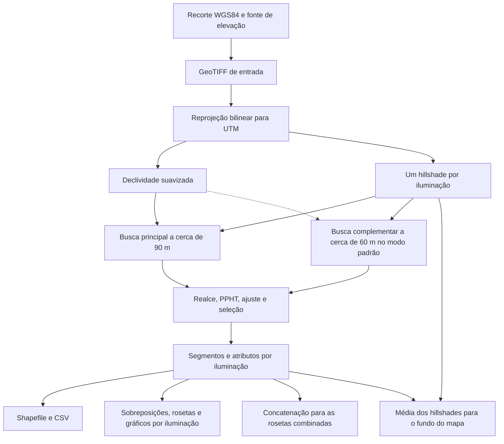

# Materiais e métodos do LinExtraction

## 1. Escopo, versão e objeto de análise

A descrição corresponde ao código do commit [`65d6080`](https://github.com/marquesbarros/linextraction/tree/65d608053e6057afe12201e75165ae50b5b2197f). A implementação está nos notebooks [em português](Extracao_de_lineamentos_SRTM.ipynb) e [em inglês](SRTM_Lineament_Extraction.ipynb), no adaptador [`linextraction_dem.py`](linextraction_dem.py) e nos [testes de aquisição](tests/test_linextraction_dem.py). Os índices de célula usados abaixo começam em zero e incluem as células de texto. A bibliografia completa está em [REFERENCES.md](REFERENCES.md). Os resultados de verificação, as condições de reprodução e o protocolo experimental estão em [VALIDATION.md](VALIDATION.md).

O objeto medido é um **segmento retilíneo em planta com suporte em um eixo escuro do relevo sombreado**, extraído sob uma configuração específica de iluminação. O produto é um inventário de **candidatos a lineamentos topográficos**. Uma feição natural pode estar representada por vários segmentos e uma representação linear pode ter mais de uma origem geomorfológica. A atribuição de origem estrutural exige evidências geológicas independentes. [O’Leary et al. (1976)](REFERENCES.md#oleary-1976) · [Wise et al. (1985)](REFERENCES.md#wise-1985) · [Masoud e Koike (2011)](REFERENCES.md#masoud-koike-2011)

O uso de lineamentos para descrever alinhamentos regionais antecede a cartografia digital. A distinção terminológica proposta por O’Leary et al. relaciona a feição cartográfica à possibilidade de expressão de uma estrutura do substrato. O LinExtraction adota um critério operacional baseado na imagem. A interpretação manual incorpora contexto e continuidade morfológica. Métodos automatizados podem usar bordas, eixos e agrupamento multiazimute. A abordagem aqui auditada usa eixos escuros, propostas de Hough e ajuste segmentar, com execução independente para cada iluminação. [Hobbs (1904)](REFERENCES.md#hobbs-1904) · [O’Leary et al. (1976)](REFERENCES.md#oleary-1976) · [Šilhavý et al. (2016)](REFERENCES.md#silhavy-2016)

O diagrama resume os fluxos de dados. A precedência efetiva entre a busca principal, os eixos escuros e o recurso à busca fina está na [seção 6](#6-busca-complementar-e-precedência-de-seleção).

## 2. Dados de entrada e configuração

### 2.1 Fontes de elevação

Um MDE discretiza uma superfície como amostras de altura. A grandeza observada depende do sensor e do processamento. MDS designa um modelo digital de superfície (*digital surface model*, DSM), que pode incluir cobertura vegetal e edificações. MDT designa um modelo digital de terreno (*digital terrain model*, DTM) que procura representar o terreno. O significado da altura, os erros espacialmente estruturados e a resolução efetiva variam entre os produtos. O tamanho nominal da célula e a exatidão vertical são grandezas distintas. [Farr et al. (2007)](REFERENCES.md#farr-2007) · [Florinsky (1998)](REFERENCES.md#florinsky-1998) · [Grohmann (2018)](REFERENCES.md#grohmann-2018)

| Parâmetro | Produto, origem e grade nominal | Referências espaciais declaradas pelo provedor | Rota efetiva do LinExtraction |
| --- | --- | --- | --- |
| `srtm`, padrão | SRTMGL1 V003, interferometria radar em banda C da missão de fevereiro de 2000, com preenchimento de vazios na versão 3. Espaçamento de 1″, classe nominal de 30 m. A superfície radar depende da cobertura. | WGS84 horizontal e alturas referidas ao EGM96. | `download_srtm` solicita `@srtm_relief_01s` ao `pygmt.grdcut`. O GMT reúne os mosaicos disponíveis na sua distribuição e usa seu cache. Um NetCDF temporário é convertido em GeoTIFF de banda única, `float32`, com `NaN` como NoData e compressão LZW. [Farr e NASA JPL](REFERENCES.md#farr-2007) · [Distribuição GMT](REFERENCES.md#gmt-srtm) |
| `copernicus` | Copernicus DEM GLO‑30, MDS derivado do WorldDEM de base TanDEM‑X, com edição e insumos complementares. Espaçamento de 1″ em latitude e espaçamento longitudinal variável segundo a latitude na especificação do produto. | WGS84 horizontal e EGM2008 vertical. | `download_copernicus` lê COGs públicos na AWS. Para o retângulo solicitado, lista geocélulas de 1° pelo piso das coordenadas mínimas até o teto das máximas, exclusivo. Usa `rasterio.merge.merge` com resolução de 1″ nos dois eixos, vizinho mais próximo e precedência do primeiro valor válido, conforme os padrões da biblioteca. Exporta a primeira banda em `float32` com `NaN` e LZW. [Manual Copernicus e AWS](REFERENCES.md#copernicus-handbook) · [Rasterio/GDAL](REFERENCES.md#rasterio-gdal) |
| `alos` | ALOS World 3D–30 m, MDS fotogramétrico derivado de estereoscopia óptica PRISM e da agregação do MDS AW3D. Classe nominal de 30 m. | WGS84 horizontal e EGM96 vertical no catálogo OpenTopography. | `download_opentopography` chama a API Global DEM com `demtype=AW3D30` e solicita um GeoTIFF recortado. A versão 3.2 é a identificada no catálogo consultado. [Tadono et al. e catálogo AW3D30](REFERENCES.md#tadono-2016) |
| `anadem` | ANADEM, MDT para a América do Sul derivado do GLO‑30 pela redução do viés associado à vegetação. A publicação descreve treinamento com altimetria GEDI, variáveis espectrais e árvores com boosting, e avaliação de alturas com ICESat‑2. Classe nominal de 30 m. | Catálogo da coleção: SIRGAS 2000 horizontal (EPSG:4674) e EGM2008 vertical. A revisão auditada esperava EPSG:4326 na resposta da API. A interface atual aceita também EPSG:4674 e preserva o CRS recebido. | A mesma função solicita `demtype=ANADEM`. A resolução e a referência da resposta devem ser conferidas no GeoTIFF da execução. [Laipelt et al. e catálogo ANADEM](REFERENCES.md#laipelt-2024) · [API](REFERENCES.md#opentopo-api) |

Na rota OpenTopography, o adaptador envia os limites, `outputFormat=GTiff` e a chave OpenTopography. Na revisão auditada, a configuração usa a variável de ambiente `OPENTOPOGRAPHY_API_KEY`. A interface interativa atual também permite informar a chave em campo oculto na célula de aquisição. O tempo limite da requisição é 180 s. O arquivo temporário é aberto para verificar o CRS aceito pela rota, dimensões mínimas de duas linhas e duas colunas e a presença de dados válidos na primeira banda. Somente após a verificação o arquivo é movido para o destino. O serviço determina a grade do recorte. No ANADEM, a implementação local passou a aceitar o CRS nativo EPSG:4674 informado no catálogo, além de EPSG:4326. O CRS recebido é usado na reprojeção. [`download_alternative_dem` e adaptadores](linextraction_dem.py) · [API](REFERENCES.md#opentopo-api) · [Catálogo ANADEM](REFERENCES.md#laipelt-2024)

O código valida a estrutura do recorte e a presença de amostras, sem estimar o erro altimétrico local. O manual do GLO‑30, por exemplo, especifica erro vertical absoluto inferior a 4 m como erro linear a 90% no conjunto avaliado e explicita a possibilidade de desvios locais. Esse valor é uma especificação do produto sob as condições do manual. Diferenças de sensor, vegetação, relevo, preenchimento de vazios e fontes auxiliares podem alterar as derivadas e o contraste do sombreado. O fluxo emprega as alturas disponíveis em metros e reprojeta horizontalmente. Uma comparação entre superfícies com referências verticais distintas requer verificar e, quando pertinente, harmonizar os referenciais antes de interpretar diferenças de altura. [Manual Copernicus](REFERENCES.md#copernicus-handbook) · [Farr et al. (2007)](REFERENCES.md#farr-2007) · [Florinsky (1998)](REFERENCES.md#florinsky-1998) · [Grohmann (2018)](REFERENCES.md#grohmann-2018)

### 2.2 Parâmetros acessíveis e caso de referência

Na célula 3, os cantos são fornecidos em `(latitude, longitude)` em graus decimais. O código ordena os limites nos dois eixos e envia `(oeste, leste, sul, norte)` à aquisição. O recorte é um retângulo geográfico. A ordenação simples pressupõe um recorte que não cruza o antimeridiano. A verificação de limites geográficos, por si só, não garante cobertura do produto ou adequação à UTM. Recortes extensos ou em mais de uma zona devem ser avaliados quanto à distorção. [Snyder (1987)](REFERENCES.md#snyder-1987) · [Distribuição GMT](REFERENCES.md#gmt-srtm)

| Português | Inglês | Configuração de referência |
| --- | --- | --- |
| `NOME_AREA` | `AREA_NAME` | Serra da Canastra, Minas Gerais |
| `CANTO_1` e `CANTO_2` | `CORNER_1` e `CORNER_2` | `(-20.36, -46.72)` e `(-20.11, -46.31)` |
| `MODELO_ELEVACAO` | `ELEVATION_MODEL` | `srtm` |
| `ILUMINACOES` | `ILLUMINATIONS` | `(45, 45)`, `(135, 45)`, `(225, 45)`, `(315, 45)`, na ordem azimute e elevação em graus |
| `COMPRIMENTO_MINIMO_M` | `MIN_LENGTH_M` | 600 m, aplicado na grade de trabalho |
| `SENSIBILIDADE` | `SENSITIVITY` | `muito-alta` ou `very-high` |
| `PASTA_SAIDA` | `OUTPUT_DIR` | `linextraction_resultados/<área>/` |

Cada lista contém ao menos um par único e satisfaz $0\leq A<360^\circ$ e $0\leq h\leq90^\circ$, em que $A$ é o azimute de iluminação e $h$ sua elevação. Os parâmetros do detector são configurações operacionais do código. A calibração independente dos valores numéricos da lista, do comprimento de 600 m e da configuração de sensibilidade padrão permanece em aberto.

### 2.3 Reprojeção, interpolação e escala de trabalho

`reproject_to_utm` usa `Rasterio/GDAL`, preserva a primeira banda e propaga a máscara do raster. A partir dos limites do raster transformados em EPSG:4326, calcula a longitude $\lambda_c$ e a latitude $\varphi_c$ pela média dos extremos em cada eixo. A zona é

$$
z=\min\!\left(60,\left\lfloor\frac{\lambda_c+180}{6}\right\rfloor+1\right).
$$

Os ângulos nessa expressão estão em graus. A referência escolhida é EPSG:$(32700+z)$ para $\varphi_c<0$ e EPSG:$(32600+z)$ caso contrário. O próprio raster recebe uma nova transformação afim e dimensões propostas por `calculate_default_transform`. A chamada dos notebooks deixa `resolution=None`. Portanto, $\Delta_x$ e $\Delta_y$, as dimensões da célula UTM em metros, são determinadas pelo GDAL a partir da entrada e da transformação, sem imposição de exatamente 30 m. Na Canastra, o raster de trabalho observado tem 1.462 colunas, 952 linhas e célula quadrada de 29,500906 m em EPSG:32723. [Snyder (1987)](REFERENCES.md#snyder-1987) · [Rasterio/GDAL](REFERENCES.md#rasterio-gdal) · [Caso de referência](VALIDATION.md#caso-de-referência-na-serra-da-canastra)

A reprojeção usa `Resampling.bilinear`. Para uma posição inversamente mapeada a $(u,v)$ dentro de quatro amostras válidas, $0\le u,v\le1$ são frações adimensionais na célula de origem e

$$
Z(u,v)=(1-u)(1-v)Z_{00}+u(1-v)Z_{10}+(1-u)v Z_{01}+uv Z_{11}.
$$

$Z_{ab}$ e $Z(u,v)$ são alturas em metros. O GDAL trata as amostras inválidas segundo sua política de máscara e NoData. O código de reprojeção parte do CRS presente no raster e assume EPSG:4326 quando ele falta. Os adaptadores das fontes alternativas validam o CRS conforme a rota. A interpolação muda a grade de amostragem e pode suavizar gradientes, sem recuperar detalhe espacial que o sensor original deixou de resolver. [Rasterio/GDAL](REFERENCES.md#rasterio-gdal) · [Florinsky (1998)](REFERENCES.md#florinsky-1998)

## 3. Relevo sombreado e declividade

**Correspondência com o código.** `hillshade`, `terrain_slope` e `make_hillshades`, células 8–9. A formulação lambertiana é fundamentada no mapa de reflectância discutido por Horn. O estêncil usado é o de `numpy.gradient`, com diferenças centrais no interior e diferenças unilaterais de primeira ordem nas bordas da matriz. A rotina não chama `gdaldem hillshade` nem o estêncil ponderado $3\times3$ frequentemente associado a Horn. [Horn (1981)](REFERENCES.md#horn-1981) · [NumPy/SciPy](REFERENCES.md#numpy-scipy)

Considere a matriz $Z_{ij}$, com altura em metros, coluna $j$ crescente para leste e linha $i$ crescente para sul. As derivadas discretas são $p = \partial Z/\partial x_{\text{leste}}$ e $q=\partial Z/\partial y_{\text{sul}}$, obtidas dividindo as diferenças em cada eixo pelo espaçamento em metros. Por exemplo, $p_{ij}=(Z_{i,j+1}-Z_{i,j-1})/(2\Delta_x)$ no interior. As duas derivadas têm unidade m/m. O código calcula a inclinação $\beta=\arctan\sqrt{p^2+q^2}$, o ângulo de aspecto interno $\psi=\operatorname{atan2}(q,-p)$ e converte o azimute de grade para $\gamma=(450^\circ-A)$ em radianos. Com $h$ convertido em radianos, obtém:

$$
I=\sin h\cos\beta+\cos h\sin\beta\cos(\gamma-\psi)
 =\frac{\sin h + \cos h\,(-p\sin A+q\cos A)}
 {\sqrt{1+p^2+q^2}}.
$$

Na forma à direita, $A$ também está em radianos. $I$ é a projeção adimensional do vetor unitário de luz sobre a normal à superfície. O GeoTIFF armazena $H=\operatorname{uint8}[\operatorname{clip}(255I,0,255)]$, com truncamento da parte fracionária. A iluminação é artificial e local, com intensidade dependente da normal e sem simulação de oclusão por outras partes do terreno. Um plano horizontal tem $I=\sin h$. A componente azimutal diminui para elevações altas e depende da orientação das vertentes. Assim, luzes opostas podem salientar lados distintos da mesma feição. [Horn (1981)](REFERENCES.md#horn-1981) · [Smith e Clark (2005)](REFERENCES.md#smith-clark-2005) · [Šilhavý et al. (2016)](REFERENCES.md#silhavy-2016)

No sombreado, células originalmente mascaradas são preenchidas com a média válida para o cálculo das derivadas. A máscara válida sofre uma erosão binária de uma iteração, com conectividade ortogonal padrão e `border_value=1`. Isso remove vizinhanças ortogonais de vazios internos, preservando a regra unilateral no limite externo. O GeoTIFF usa a máscara de validade e reserva o valor zero como intensidade legítima. Em separado, `terrain_slope` aplica filtro gaussiano com $\sigma=2$ células à matriz de alturas com o mesmo preenchimento e calcula

$$
G=\left\lVert\nabla_{\Delta_x,\Delta_y}\left(\mathcal G_2*Z\right)\right\rVert_2.
$$

$G$ é a razão entre desnível e distância horizontal em m/m, com a derivada calculada em metros, e $\mathcal G_\sigma$ é o núcleo gaussiano de desvio-padrão $\sigma$ em células. Essa camada reforça sementes nas buscas que passam por `_detect_at_scale`. Ela não alimenta o cálculo do hillshade nem a função de ajuste transversal. O preenchimento e os filtros podem influenciar posições próximas dos vazios além da vizinhança imediata excluída pela máscara. [NumPy/SciPy](REFERENCES.md#numpy-scipy) · [Florinsky (1998)](REFERENCES.md#florinsky-1998)

## 4. Geração de propostas lineares

### 4.1 Subamostragem e realce de eixos escuros

**Correspondência com o código.** `_detect_at_scale`, `_detect_dark_axes` e `detect_segments`, células 11–13. Define-se $d$, em metros, como `src.res[0]`, o espaçamento horizontal do hillshade. Para resolução-alvo $d_\ast=90$ m na busca principal ou 60 m na complementar, o passo $k$ e o espaçamento efetivo $s$ são

$$
k=\max(1,\operatorname{round}(d_\ast/d)),\qquad
s=kd,\qquad \ell_{\min}=L_{\min}/s.
$$

$\ell_{\min}$ é o comprimento mínimo em células da grade de detecção e $L_{\min}$ está em metros. A imagem é obtida por `[::k, ::k]` a partir da primeira linha e coluna, sem filtro passa-baixas específico antes dessa decimação. A declividade já suavizada é subamostrada nos mesmos índices. O detector usa $d$ como dimensão representativa dos dois eixos, pressuposto adequado à grade quadrada de referência. Para a Canastra, os espaçamentos são aproximadamente 88,50 m e 59,00 m. A subamostragem pode produzir aliasing, e escalas e tolerâncias em células correspondem a distâncias efetivas dependentes de $s$. [Shannon (1949)](REFERENCES.md#shannon-1949) · [Florinsky (1998)](REFERENCES.md#florinsky-1998)

A intensidade da imagem subamostrada é dividida por 255 e valores mascarados são substituídos pela mediana válida. Seja $J$ essa imagem adimensional. A máscara de busca $M$ é erodida por seis iterações na busca principal, três no recurso à busca fina e quatro na busca de eixos escuros. Os filtros de intensidade são calculados na imagem preenchida. Os quantis e a seleção usam a máscara de busca ou o subconjunto elegível indicado nas fórmulas. A rotina retorna uma lista vazia quando a máscara interior está vazia, quando $\ell_{\min}$ excede a diagonal da matriz em células ou quando o critério de elegibilidade da busca não é atendido.

A Hessiana na escala $\sigma$, em células, representa as segundas derivadas da imagem suavizada. Com $J_s$ a base suavizada usada pelo detector e $\lambda_1\geq\lambda_2$ os autovalores da Hessiana de $\mathcal G_\sigma*J_s$, a versão bidimensional de `sato` em scikit-image 0.26.0, com `black_ridges=True`, calcula

$$
R(J_s)=\max_{\sigma\in\Sigma}\bigl[\sigma^2 \max(\lambda_1,0)\bigr].
$$

Uma estrutura escura tem uma seção normal com curvatura positiva na convenção de intensidade do código. O fator $\sigma^2$ normaliza a ordem da derivada. As derivadas gaussianas da biblioteca trabalham em coordenadas da imagem, de modo que a resposta normalizada acompanha a escala de intensidade, sem unidade física de curvatura topográfica. A formulação original foi desenvolvida para estruturas curvilíneas em imagens médicas tridimensionais. O LinExtraction usa a redução bidimensional da biblioteca, no sombreado, e acrescenta os critérios de proeminência, polaridade, validação transversal e seleção descritos a seguir. [Sato et al. (1998)](REFERENCES.md#sato-1998) · [Implementação scikit-image 0.26.0](REFERENCES.md#scikit-image-026)

### 4.2 Sementes da busca principal e do recurso à busca fina

Nos dois modos de `_detect_at_scale`, a imagem de base é $J_s=\mathcal G_{0.85}*J$, com escalas de Sato $\Sigma=\{2,\ 3{,}4\}$ células. A proeminência escura $P$, a resposta combinada $W$, a escuridão $D$ e o escore de sementes $W_s$ são

$$
\begin{aligned}
P&=\max(\mathcal G_b*J-J_s,\ 0),&W&=\sqrt{R(J_s)P},\\
D&=\operatorname{clip}\bigl((\operatorname{mediana}_M(J_s)-J_s)/0.30,\ 0,\ 1\bigr),&
W_s&=W(0.65+0.35D)\bigl[1+0.20\operatorname{clip}(G/0.35,\ 0,\ 1)\bigr].
\end{aligned}
$$

O raio característico $b$ é o desvio-padrão do gaussiano de fundo, igual a seis células. Somente no recurso à busca fina, se o percentil 99 de $P$ no interior for inferior à proeminência mínima, $b$ passa a nove células. $P$, $D$, $W$ e $W_s$ são escores em intensidade normalizada ou adimensionais. O termo de declividade só é aplicado se a camada $G$ foi passada, como ocorre nos notebooks. $\sigma=0.85$, $b$, 0,30, os pesos e as escalas são escolhas de implementação.

Defina $V=\{M,\ P>p_{\min},\ W>0\}$, isto é, a interseção dos três critérios. Seja $Q_a(X\mid U)$ o quantil $a$ de $X$ no conjunto $U$, com a interpolação padrão do NumPy. O limiar de sementes é $T_s=\max[Q_a(W_s\mid M),Q_{0.10}(W_s\mid V)]$. As duas máscaras são $V\cap\{W_s>0.88T_s\}$ e $V\cap\{W_s>1.22T_s\}$. Ambas são afinadas mediante `skeletonize`, que em 2D usa o método de Zhang e Suen oferecido pela biblioteca. Uma dilatação ortogonal unitária do primeiro esqueleto fornece uma terceira máscara para Hough. O limiar de ajuste é calculado separadamente com $W$ no lugar de $W_s$, preservando a independência do ajuste em relação à declividade. [Zhang e Suen (1984)](REFERENCES.md#zhang-suen-1984) · [scikit-image 0.26.0](REFERENCES.md#scikit-image-026) · [NumPy/SciPy](REFERENCES.md#numpy-scipy)

| Sensibilidade PT / EN | $a$ | $p_{\min}$ | Cobertura nominal | Cobertura efetiva em `_detect_at_scale` | Votos nas duas máscaras afinadas | Teto da busca principal |
| --- | ---: | ---: | ---: | ---: | ---: | ---: |
| conservadora / conservative | 0,91 | 0,015 | 0,68 | 0,68 | 9 | 32 |
| moderada / moderate | 0,88 | 0,013 | 0,64 | 0,64 | 8 | 48 |
| alta / high | 0,84 | 0,011 | 0,59 | 0,62 | 7 | 72 |
| muito-alta / very-high | 0,79 | 0,009 | 0,54 | 0,62 | 6 | 96 |

A cobertura efetiva é o máximo entre 0,62 e o valor nominal. Estes parâmetros constam em `Sensitivity` e `SENSITIVITIES`. O teto e os limiares variam simultaneamente entre perfis. A diferença entre perfis em uma aplicação depende dos candidatos formados, das rejeições e da saturação dos tetos.

### 4.3 Transformada de Hough probabilística progressiva

Para um ponto $(x,y)$ no plano da imagem, em células com $x$ para a direita e $y$ para baixo, as linhas candidatas satisfazem $\rho=x\cos\theta+y\sin\theta$, com $\rho$ em células e $\theta$ representando a normal à linha. Duda e Hart formularam a votação em espaço de parâmetros para retas. A PPHT intercala votação estocástica e construção de segmentos, examinando pixels de uma máscara e procurando suporte nos dois sentidos da reta. O código da biblioteca discretiza $\rho$ e aceita propostas pelo limiar de votos, pela tolerância a uma lacuna e por extensão suficiente em pelo menos uma coordenada da imagem. [Duda e Hart (1972)](REFERENCES.md#duda-hart-1972) · [Galambos et al. (1999) e Matas et al. (2000)](REFERENCES.md#ppht) · [Núcleo scikit-image](REFERENCES.md#scikit-image-026)

O LinExtraction chama `probabilistic_hough_line` com `rng=0` em cada passagem, sem vetor angular próprio. A biblioteca usa 180 ângulos da normal, espaçados de 1°, de $-90^\circ$ a $89^\circ$. Para as duas máscaras afinadas da busca principal e do recurso à busca fina, a lacuna de Hough é de 12 passos de imagem e o comprimento de proposta é $m_H=\max(3,\lceil\ell_{\min}/\sqrt{2}\rceil)$ células. Na máscara dilatada, são usados 22 votos, lacuna de sete passos e comprimento $\max(15,m_H)$. Esses valores formam propostas intermediárias. O ajuste aplica o filtro euclidiano $\ell_{\min}$. O fator $\sqrt{2}$ é compatível com a relação entre extensão por eixo e comprimento euclidiano. Propostas com os mesmos pares ordenados de extremidades são reunidas em um conjunto antes do ajuste. A semente fixa controla a ordem pseudoaleatória na biblioteca sob o ambiente usado. [Implementação scikit-image](REFERENCES.md#scikit-image-026)

## 5. Ajuste transversal, continuidade e seleção

**Correspondência com o código.** `_axis_normal`, `_transverse_peaks`, `_fit_offset` e `_refit`, célula 11. A geração das propostas usa Hough. O ajuste, a verificação do suporte e o mecanismo de seleção abaixo constituem a implementação heurística do LinExtraction. Seus pesos e tolerâncias são parâmetros operacionais cuja validade depende de avaliação independente.

### 5.1 Orientação local e amostragem transversal

A direção do maior autovalor algébrico da Hessiana de $J_s$ é

$$
\eta=\tfrac12\operatorname{atan2}(2J_{xy},J_{xx}-J_{yy}).
$$

Os termos $J_{xx},J_{yy},J_{xy}$ são segundas derivadas gaussianas em coordenadas da imagem. O desvio-padrão é de duas células em `_detect_at_scale` e de 1,55 célula em `_detect_dark_axes`. O ângulo $\eta$, em radianos, define um eixo normal local, com equivalência sob rotação de $\pi$. A Hessiana é calculada separadamente da resposta multiescala de Sato. [Sato et al. (1998)](REFERENCES.md#sato-1998) · [NumPy/SciPy](REFERENCES.md#numpy-scipy)

Para uma proposta com extremidades $P_0,P_1$ em células, defina $\ell=\|P_1-P_0\|_2$, a tangente unitária $t=(P_1-P_0)/\ell$ e a normal $n=(-t_y,t_x)$. A rotina rejeita $\ell<\ell_{\min}$ e usa $N=\lceil\ell\rceil+1$ estações equiespaçadas $u_i$ entre $0$ e $\ell$. Em cada estação, amostra o escore $S$ em $P_0+u_it+\delta n$, com deslocamentos $\delta=-2,-1{,}5,\ldots,2$ células. $S=W$ em `_detect_at_scale` e é o escore de eixos escuros restrito à elegibilidade na busca especializada. A amostra usa interpolação de ordem 1 e fica zerada quando a máscara na posição arredondada é inválida ou $|\cos(\eta-\theta_n)|<0{,}77$, em que $\theta_n$ é o ângulo da normal da proposta em radianos. Escolhe-se o deslocamento que maximiza $S(1-0.10|\delta|)$. O valor de suporte $v_i$ armazenado para os testes é o escore amostrado antes dessa penalização de distância. [NumPy/SciPy](REFERENCES.md#numpy-scipy)

### 5.2 Regressão do deslocamento e delimitação dos trechos

Com limiar de ajuste $T$, mantêm-se as amostras $v_i\geq0{,}55T$. O conjunto deve conter ao menos $\max(5,0{,}48N)$ amostras. Ajusta-se o deslocamento transversal $\delta_i=a u_i+b$ por mínimos quadrados ordinários:

$$
a=\frac{\sum_i (u_i-\overline u)(\delta_i-\overline\delta)}
        {\sum_i(u_i-\overline u)^2},
\qquad
b=\overline\delta-a\overline u.
$$

$a$ é adimensional, $b$ está em células e as médias referem-se às amostras que passaram na seleção. Excluem-se as amostras com resíduo absoluto superior a 1,15 célula. Exigem-se então $\max(5,0{,}42N)$ amostras retidas e repete-se a regressão. Rejeita-se a proposta se $|a|>\tan 14^\circ$. A reta corrigida fica $P'_0=P_0+bn$, com direção $t'=t+an$. A normal desta direção é normalizada para a próxima amostragem.

O segundo perfil é avaliado em estações de passo unitário no parâmetro $u$, de $-e$ a $\lceil\ell\rceil+e$, com $e=5$ na busca principal e $e=7$ nas buscas finas. Usa deslocamentos $\delta=-1,-0{,}5,0,0{,}5,1$ célula. O suporte ocorre quando $v_i\geq0{,}52T$. As posições com suporte são partidas sempre que seus índices sucessivos diferem em mais de quatro passos. Cada trecho retém as estações entre o primeiro e o último suporte, inclusive, e é aceito somente se:

1. houver pelo menos dois pontos com suporte e a extensão euclidiana $E$ em células for pelo menos $\ell_{\min}$
2. a proporção $C$ de estações com suporte dentro do trecho atingir a cobertura mínima da busca
3. a fração $F$ dos pontos com suporte cujo deslocamento absoluto é até 0,5 célula atingir 0,55
4. todas as estações arredondadas pertencerem à máscara válida de busca e estarem a pelo menos duas células da borda do raster de detecção

Portanto, os extremos exportáveis correspondem aos limites do intervalo reajustado com suporte. A geometria de cada trecho continua retilínea. Uma mesma proposta pode produzir vários trechos. $E$ é medido na reta corrigida, cuja direção $t'$ tem norma $\sqrt{1+a^2}$. Assim, o espaçamento geométrico na segunda etapa é essa norma em células por passo de parâmetro.

### 5.3 Ordenação e eliminação espacial de redundância

Defina $B=\min(\overline v/(3T),1)$, com $\overline v$ a intensidade média nos pontos com suporte do trecho. O escore por trecho é

$$
\mathcal Q=E^\alpha C^{1.5}(0.65+0.35F)(b_0+b_1 B),
$$

com $(\alpha,b_0,b_1)=(1,0{,}72,0{,}28)$ na busca principal e $(0{,}72,0{,}42,0{,}58)$ nas buscas finas. O escore é usado para ordenar candidatos dentro de cada busca. Ele combina uma potência de extensão em células com fatores adimensionais. Sua interpretação é de prioridade algorítmica, sem calibração probabilística. O código ordena em ordem decrescente de $\mathcal Q$ e usa as coordenadas das extremidades como desempate.

Em `_detect_at_scale`, a orientação em coordenadas da imagem é dividida em 12 classes axiais pelo arredondamento de $12\operatorname{atan2}(\Delta y,\Delta x)/\pi$ módulo 12. Um segmento aceito ocupa o entorno $3\times3$ das estações arredondadas, registrado em uma máscara de bits para sua classe. Rejeita-se um novo trecho se mais de 53% de suas estações arredondadas incidirem em células já ocupadas pela sua classe ou pelas duas adjacentes. A seleção para ao atingir o teto da busca. As classes internas de 15° são exclusivas desse teste espacial. As rosetas de saída usam uma divisão de 5° a partir de azimutes geodésicos.

Em `_add_distinct_segments`, já na grade do hillshade antes da decimação, um candidato é amostrado uniformemente nos extremos e ao longo da extensão, com $\max(2,\lceil L_p d/60\rceil+1)$ pontos. $L_p$ é seu comprimento em células da grade do hillshade, $d$ o espaçamento em metros e 60 a distância de referência em metros. Compara-se apenas com segmentos aceitos cuja diferença axial é de até 20°. Para um ponto $X$ e um segmento aceito de origem $P$ e vetor $v$, usa-se a distância em células

$$
D(X,P,v)=\bigl\|X-P-\tau v\bigr\|_2,
\qquad
\tau=\operatorname{clip}\left(\frac{(X-P)\cdot v}{v\cdot v},0,1\right).
$$

Rejeita-se o candidato se pelo menos 45% de suas amostras estiverem a até $120/d$ células de qualquer segmento aceito elegível. O limiar de 120 m corresponde à escala métrica assumida pela rotina de deduplicação. A comparação é com segmentos finitos, e candidatos novos podem ser rejeitados em relação a segmentos inicialmente aceitos ou incorporados no mesmo percurso de seleção.

## 6. Busca complementar e precedência de seleção

A execução ocorre separadamente para cada hillshade na célula 13. Todos os perfis executam primeiro `_detect_at_scale(..., fine=False)`. O notebook autoriza até 24 segmentos adicionais apenas para `muito-alta` ou `very-high`. Nos outros perfis, o limite complementar é zero e a rotina retorna a seleção principal.

Em `_detect_dark_axes`, usa-se passo $k$ para o alvo de 60 m, erosão de quatro iterações, $J_s=\mathcal G_{0.55}*J$, fundo $\mathcal G_5*J$ e $\Sigma=\{1,\ 1{,}6,\ 2{,}5\}$ células no Sato. Com $P=\max(\mathcal G_5*J-J_s,0)$ e $D$ definido na seção 4, o escore é

$$
S_{\mathrm{escuro}}=\sqrt{R(J_s)P}(0.36+0.64D).
$$

A elegibilidade $U$ exige máscara interior, $P>0{,}028$, $D>0{,}10$ e $S_{\mathrm{escuro}}>0$. O limiar $T=\max[Q_{0.94}(S_{\mathrm{escuro}}\mid M),Q_{0.12}(S_{\mathrm{escuro}}\mid U)]$ produz dois esqueletos com cortes de $0{,}82T$ e $1{,}22T$. A PPHT usa $\max(7,\operatorname{round}(0.7\ell_{\min}))$ votos, lacuna $\max(3,\operatorname{round}(185/s))$ em passos de imagem e comprimento mínimo de proposta $m_H$. O valor 185 está em metros. No ajuste, o escore de suporte é zerado fora de $U$, a normal local usa $\sigma=1{,}55$ e a cobertura mínima é 0,72. Essa busca especializada usa somente o hillshade. [Implementação nas células 11–13](Extracao_de_lineamentos_SRTM.ipynb)

A reserva de candidatos da busca complementar vale o maior valor entre o teto principal e cinco vezes o teto complementar, ou 120 no padrão. A rotina de eixos escuros ordena os candidatos, elimina redundância interna pela tolerância de 120 m e os oferece à seleção, que preserva os segmentos principais e acrescenta apenas segmentos suficientemente distintos. Se ainda houver vagas, executa-se `_detect_at_scale(..., fine=True)`, com alvo de 60 m, erosão de três células, os parâmetros por sensibilidade da seção 4 e o ajuste fino da seção 5. Esse recurso pode usar a declividade para as sementes, como a busca principal. Os novos segmentos passam pelo mesmo teste de distinção contra os já aceitos e respeitam as vagas restantes. O total por iluminação no padrão é, portanto, de até 120 segmentos. O código pode devolver menos. [Implementação nas células 11–13](Extracao_de_lineamentos_SRTM.ipynb)

## 7. Georreferenciamento e atributos

**Correspondência com o código.** `extract_hillshade_lines`, `_measure` e `_write_lineaments`, células 12 e 15–16. As extremidades ajustadas $(x,y)$ em células da grade de detecção são multiplicadas por $k$. Obtêm-se, assim, coluna $c=kx$ e linha $r=ky$, potencialmente fracionárias, na grade UTM do hillshade. Com a transformação afim do raster, denotada por matriz $M_r$, a chamada `src.xy(r, c)` com o deslocamento padrão para o centro da célula equivale a

$$
\begin{pmatrix}X\\Y\\1\end{pmatrix}
=M_r\begin{pmatrix}c+1/2\\r+1/2\\1\end{pmatrix}.
$$

$X,Y$ estão em metros na UTM do recorte. Conectam-se os dois pontos com uma `LineString` bidimensional. A seleção por $L_{\min}$ se dá pelo comprimento na grade de detecção, antes do cálculo geodésico. A seleção por comprimento termina antes do cálculo geodésico dos atributos. [Rasterio/GDAL](REFERENCES.md#rasterio-gdal) · [Snyder (1987)](REFERENCES.md#snyder-1987)

As extremidades $P_0,P_1$ em UTM são ordenadas lexicograficamente para tornar o procedimento consistente. O ponto médio em planta é $P_c=(P_0+P_1)/2$. A transformação inversa $g$ da UTM para WGS84 usa `always_xy=True` e retorna longitude, latitude. A rotina geodésica inversa de `pyproj.Geod(ellps="WGS84")` é aplicada a $g(P_0),g(P_1)$ para obter o comprimento $L$ em metros. Aplica-se a mesma função a $g(P_c),g(P_1)$ para obter o azimute direto $A_g$ em graus a partir do norte verdadeiro. A orientação exportada é $\phi=A_g\bmod180^\circ$, com proteção para encaminhar um eventual valor de 180° a zero. O ponto médio é construído no plano UTM, e $L$ é a distância no elipsoide, sem componente altimétrica. [Karney (2013) e PROJ](REFERENCES.md#karney-2013)

| Campo comum ao CSV e ao Shapefile | Definição |
| --- | --- |
| `id` | Identificador sequencial `L0001`, `L0002` etc., local à execução e atribuído na ordem das iluminações e das detecções |
| `lon_c`, `lat_c` | Longitude e latitude em graus decimais, WGS84, do ponto médio da geometria plana transformado |
| `comp_m` | Comprimento geodésico elipsoidal $L$, em metros |
| `strike` | Orientação axial $\phi$ do segmento em planta, em graus de norte verdadeiro, em $[0,180)$ |
| `az_luz`, `alt_luz` | Azimute da luz a partir do norte de grade UTM e elevação da luz acima do horizonte, em graus |

O norte verdadeiro empregado em `strike` e o norte de grade usado em `az_luz` podem diferir pela convergência meridiana. `strike` descreve a geometria em planta, e `alt_luz` ou a segunda componente da legenda `Az/Dip` descreve a luz artificial. A medição do mergulho ou da atitude de uma estrutura geológica exige dados próprios. [Snyder (1987)](REFERENCES.md#snyder-1987) · [O’Leary et al. (1976)](REFERENCES.md#oleary-1976)

## 8. Distribuições direcionais e agregação

**Correspondência com o código.** `orientation_values`, `class_percentages`, `shared_radial_ticks`, `save_rose` e `save_cartesian`, células 15–16 e 20. Orientações axiais descrevem eixos com equivalência $\phi\sim\phi+180^\circ$. Para $\Delta=5^\circ$, o código desloca cada $\phi_i$ por $\Delta/2$ e reduz módulo 180°. A classe $j=\lfloor[(\phi_i+\Delta/2)\bmod180^\circ]/\Delta\rfloor$, com $j=0,\ldots,35$, tem centro em $j\Delta$. A classe zero inclui a vizinhança de 0° dos dois lados da junção axial. Definem-se

$$
N_j=\sum_i\mathbf{1}_{j(i)=j},
\qquad
W_j=\sum_i L_i\,\mathbf{1}_{j(i)=j},
\qquad
P_j(X)=100\,X_j/\sum_k X_k,\quad X\in\{N,W\}.
$$

$N_j$ é o número de segmentos, $W_j$ é a soma intraclasse em metros e $P_j$ é a porcentagem relativa ao denominador da métrica correspondente. Para um total zero, a função retorna zeros em todas as classes. O código confirma que as classes recuperam o número de registros e a soma dos comprimentos e que os percentuais somam aproximadamente 100% quando o total é positivo. Alterar a largura ou a origem das classes pode alterar posições e alturas de máximos do histograma, especialmente quando há orientações próximas a limites de classe. [Mardia e Jupp (2000)](REFERENCES.md#mardia-jupp-2000)

- `rosetas/segmentos/` apresenta $P_j(N)$ e, no gráfico cartesiano, $N_j$ absoluto.
- `rosetas/frequencia/` apresenta $P_j(W)$ e, no gráfico cartesiano, $W_j$ absoluto. O diretório tem nome histórico. A soma de comprimentos é reiniciada em cada classe.
- Nas rosetas, 0° fica no norte e o ângulo aumenta no sentido horário até 180°. O raio é proporcional ao percentual. A classe de 0° é desenhada em duas metades na junção 0°/180°, com uma única contribuição para a estatística. A anotação `n = N` informa o número de segmentos, inclusive nas rosetas de comprimento. A escala radial por métrica usa o maior percentual entre as iluminações e arredondamento por `MaxNLocator`, com base mínima de 5% para a geração dos ticks e limite de 100%. Com raio linear em percentual, a área do setor cresce com o quadrado do raio. A leitura quantitativa deve usar as marcas radiais.
- Os gráficos cartesianos mantêm a métrica absoluta em função do centro de classe, marcam o eixo angular a cada 15° e usam poucas marcas no eixo vertical. Para a soma de comprimentos, o formatador pode usar potência de dez, mantendo a grandeza em metros. As cores seguem a ordem dos pares de iluminação, como nas sobreposições e rosetas individuais.

A série combinada usa **todos os registros exportados**. Para a métrica $X$, a distribuição combinada da classe $j$ equivale à média das distribuições por iluminação ponderada pelo total de $X$ em cada iluminação. O código também renderiza as linhas de cada origem sobre a média aritmética dos hillshades quantizados na grade comum, empregando suas máscaras. Essa média serve para visualização. A etapa de detecção opera em cada hillshade individual. O arquivo combinado mantém as geometrias tal como detectadas e a agregação mantém recorrências entre iluminações como registros distintos. Uma feição recorrente contribui tantas vezes quantos registros houver e pode aumentar tanto a contagem quanto a soma do comprimento em certas direções. [Mardia e Jupp (2000)](REFERENCES.md#mardia-jupp-2000) · [Masoud e Koike (2011)](REFERENCES.md#masoud-koike-2011) · [Šilhavý et al. (2016)](REFERENCES.md#silhavy-2016)

## 9. Produtos, rastreabilidade e adaptação metodológica

O raster de entrada fica em `srtm/srtm.tif` ou `dem/<modelo>.tif`, conforme a fonte. Os hillshades GeoTIFF preservam a afim, o CRS UTM e a máscara e registram `azimute` e `altura`. O Shapefile em `shapefile/lineamentos.shp` e seus arquivos auxiliares armazenam a geometria em UTM e os atributos. O CSV `lineamentos.csv` preserva os atributos sem a geometria. A célula 18 compara os atributos dos dois formatos, verifica o CRS do vetor, a unicidade dos identificadores, a faixa de `strike` e o número de pontos por linha. O diretório final usa o nome da área, com sufixo quando essa saída já existe. O MDE UTM intermediário é temporário, e os painéis e as figuras combinadas são gravados na etapa posterior de visualização. As figuras da revisão auditada eram exportadas em PNG. A interface local atual exporta em SVG por padrão e oferece PNG. Os rasters e vetores preservam o georreferenciamento. [Rasterio/GDAL](REFERENCES.md#rasterio-gdal)

A aquisição registra em saída da célula o nome da fonte, SHA‑256 do GeoTIFF de entrada utilizado, CRS, dimensões e espaçamento horizontal UTM e a data local. O modo padrão por SRTM é independente do adaptador de fontes alternativas. Os notebooks contêm saídas executadas historicamente na Canastra. As sobreposições e rosetas na última célula são exemplos de produtos reais. Elas demonstram o formato e a distribuição do inventário, com o alcance experimental detalhado em [VALIDATION.md](VALIDATION.md#caso-de-referência-na-serra-da-canastra). A lista de mosaicos, sua versão de distribuição, os parâmetros completos, a proveniência de cada pixel, a etapa de seleção de cada linha e os escores intermediários não são registrados sistematicamente nos produtos vetoriais. Para replicação, arquivam-se o MDE efetivamente usado, suas fontes e o ambiente, conforme [VALIDATION.md](VALIDATION.md#reprodução).

| Operação preexistente | Uso e adaptação no LinExtraction |
| --- | --- |
| Reflectância lambertiana e gradiente discreto | Uso de diferenças NumPy, quantização de 8 bits, convenção explícita de linha crescente para sul e máscara erodida |
| Hessiana multiescala de Sato | Redução 2D de scikit-image aplicada a intensidades sombreadas, combinada com proeminência gaussiana, escuridão e, quando pertinente, declividade |
| Afinamento e PPHT | Afinamento 2D da biblioteca e PPHT em máscaras com múltiplos cortes, mais uma passagem em máscara dilatada nas buscas em `_detect_at_scale` |
| Ajuste e seleção | Regressão transversal de deslocamentos, critérios de suporte, escore, ocupação angular da imagem e exclusão por proximidade em uma busca complementar |
| Cálculo geodésico e estatística axial | Transformação afim e inversa em WGS84, contagem e peso de metros por classe, agregação entre iluminações por concatenação |

A integração dessas operações é a descrição do trabalho computacional auditado. Uma alegação de novidade, superioridade ou robustez comparativa requer comparação com métodos de referência sob um protocolo comum. [Horn (1981)](REFERENCES.md#horn-1981) · [Sato et al. (1998)](REFERENCES.md#sato-1998) · [PPHT](REFERENCES.md#ppht) · [Šilhavý et al. (2016)](REFERENCES.md#silhavy-2016)

## 10. Interpretação geológica e limites de inferência

**Origem das respostas.** Vales alinhados, canais e bordas de drenagem, vertentes de cristas, escarpas, contatos litológicos com expressão topográfica, feições erosivas e elementos antrópicos podem produzir eixos lineares. Fraturas e falhas podem controlar algumas dessas formas, mas o mecanismo causal deve ser estabelecido em cada contexto. O escore responde ao contraste do sombreado, à curvatura de intensidade e à continuidade em planta. O conceito de candidato mantém a separação entre o traço observado e a hipótese sobre sua origem. A confirmação estrutural exige observações de campo, cartografia estrutural ou evidências geofísicas independentes e compatíveis com a escala. [O’Leary et al. (1976)](REFERENCES.md#oleary-1976) · [Wise et al. (1985)](REFERENCES.md#wise-1985) · [Masoud e Koike (2011)](REFERENCES.md#masoud-koike-2011) · [Ângelo da Silva Neto et al. (2022)](REFERENCES.md#silva-neto-2022)

**Iluminação e resolução.** A componente direcional da reflectância condiciona a ocorrência de faixas escuras. Uma única orientação pode favorecer vertentes e trechos que geram mais contraste sob aquele azimute. Vários azimutes ampliam as vistas disponíveis, mas cada vista continua sujeita a esse efeito e compartilha o mesmo MDE com as demais. Altura de vegetação, edifícios, vazios, emendas de mosaicos, gradientes suavizados e artefatos direcionais podem alterar as detecções. O catálogo do ANADEM registra a possibilidade de faixas ou padrões de mosaico locais que se tornam mais visíveis em derivados. O efeito depende do produto, do local, da preparação do raster e do parâmetro examinado. [Smith e Clark (2005)](REFERENCES.md#smith-clark-2005) · [Šilhavý et al. (2016)](REFERENCES.md#silhavy-2016) · [Grohmann (2018)](REFERENCES.md#grohmann-2018) · [Catálogo do ANADEM](REFERENCES.md#laipelt-2024)

**Unidade observacional.** O comprimento mínimo, a busca por retas, a decimação, os limiares, a rejeição por proximidade e os tetos condicionam a amostra. Uma estrutura curva pode aparecer como vários fragmentos. Uma estrutura sem expressão topográfica detectável pode ficar ausente. Uma feição visível sob vários azimutes pode ser recontada. Por isso, $N_j$ é frequência de segmentos por classe e $W_j$ é a extensão total dos segmentos registrados na classe, ambas condicionadas ao procedimento. Uma inferência sobre a abundância, extensão ou orientação de populações de estruturas naturais requer controle de fragmentação, repetição, detectabilidade diferencial e dependência espacial. [Mardia e Jupp (2000)](REFERENCES.md#mardia-jupp-2000) · [Wise et al. (1985)](REFERENCES.md#wise-1985) · [Šilhavý et al. (2016)](REFERENCES.md#silhavy-2016) · [Roberts et al. (2017)](REFERENCES.md#roberts-2017)
